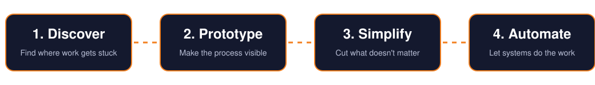

## I understand people and processes. Then I build systems optimized for growth.

I design and ship custom systems that bring clarity to a business, simplify and automate its processes, and get it ready to scale. I build for teams that collaborate across departments, and help them actually adopt the technology.

### How I got started

I led a Creative & Digital Advertising department that works with multiple stakeholders. Coordinating work between 50+ people taught me where work gets stuck: handoffs, unclear ownership, and quality that nobody checks. So I learned engineering to build tools that fit how my team really works. Since then I've shipped production-grade systems: work management, server-side tracking, a landing page builder, and more.

## Tech stack

| | |
|---|---|
| **Database** |    |
| **Backend** |    |
| **Frontend** |    |
| **Mobile** |  |
| **Automation and tracking** |   Meta Conversions API, Google Ads |
